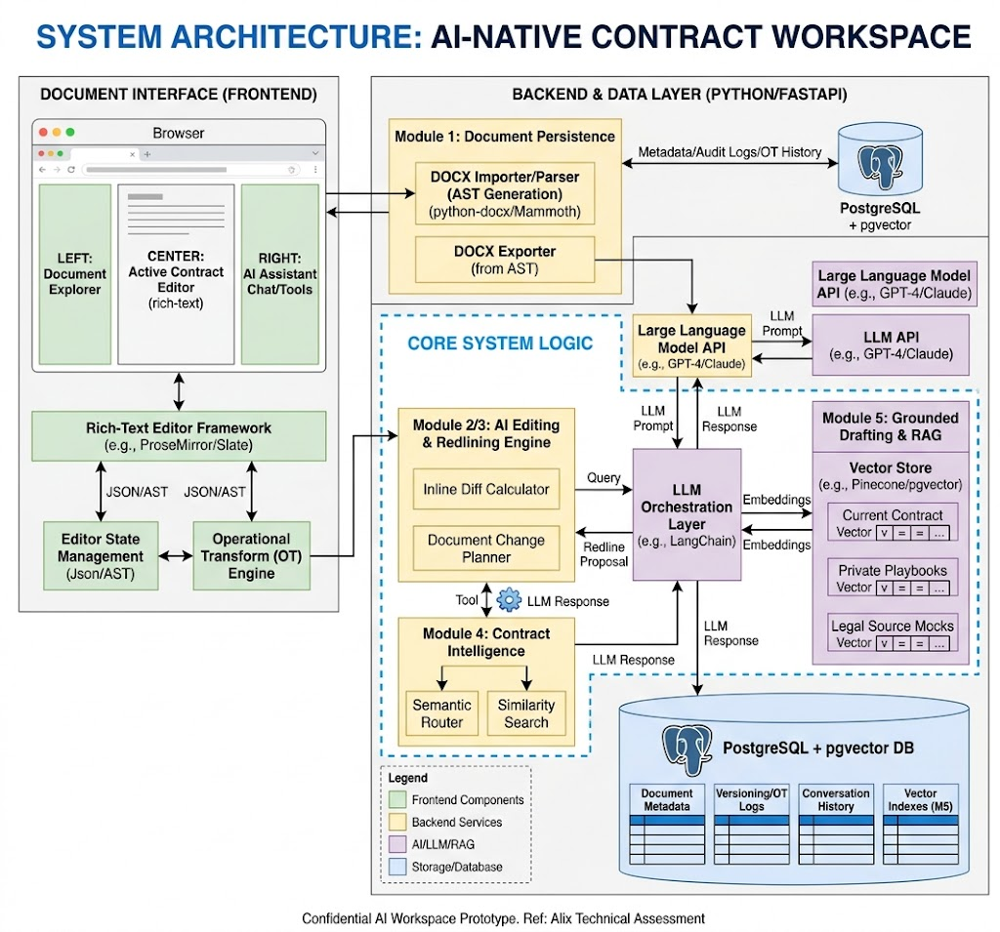

# Alix

Legal tech platform for contract AST analysis and vector search. Built with React + Vite and FastAPI, SQLAlchemy 2.0, PostgreSQL + pgvector, and Alembic.



---

## Project Structure

```text
alix-assessment/
├── alix-workflow.jpg
├── docker-compose-local.yml   # Docker setup (db + backend)
|── frontend/                  # React + Vite application
└── backend/                   # Python app root - run everything from here
    ├── main.py
    ├── alembic/               # Migrations
    ├── alembic.ini
    ├── admin/                 # SQLAdmin views & templates
    ├── api/                   # API routes
    ├── core/
    │   ├── config/settings.py
    │   ├── database.py
    │   └── models/            # SQLAlchemy models (pgvector 3072-dim)
    ├── ds/                    # Data science / RAG modules
    ├── requirements/
    ├── scripts/
    ├── Dockerfile
    └── .env                   # App config (copy from .env.example)
```


## Git flow
1. Run `pip install pre-commit ruff`
2. Run `pre-commit install`

After that when commiting your changes pre-commit hook will check formatting in your changes.
It will fix them if something is wrong, you can inspect affected files and commit again afterward.


---

## Quick Start (Docker)

```bash
# From project root
docker compose -f docker-compose-local.yml up -d
```

Uses `pgvector/pgvector:pg16` — **pgvector is included and managed automatically**. No manual extension setup needed.

Copy `backend/.env.example` → `backend/.env` and set `DB_HOST=db` for full Docker, or `DB_HOST=localhost` if only running the DB container.

---

## Local Setup (Without Docker)

**Requirements:** Python 3.11+ (3.12 recommended)

### 1. Install PostgreSQL & pgvector

- [PostgreSQL downloads](https://www.postgresql.org/download/)
- [pgvector installation guide](https://github.com/pgvector/pgvector#installation)

Create your database and user, then **enable pgvector once** as a PostgreSQL superuser:

```sql
CREATE EXTENSION IF NOT EXISTS vector;
```

> Your app user (e.g. `alix`) cannot run this — use the `postgres` superuser.

### 2. Configure & run

```bash
cd backend
python -m venv venv
venv\Scripts\activate          # Windows
pip install -r requirements/backend.txt

copy .env.example .env         # set DB_HOST=localhost and credentials

alembic upgrade head
uvicorn main:app --reload --port 8000
```

---

## Backend URLs

| Service | URL |
|---------|-----|
| Swagger | http://localhost:8000/docs |
| ReDoc | http://localhost:8000/redoc |
| Admin Panel | http://localhost:8000/admin |
| Health Check | http://localhost:8000/test/ |

Admin credentials are set in `backend/.env` (`ADMIN_USERNAME` / `ADMIN_PASSWORD`).

---

## Migrations

Run from `backend/`:

```bash
alembic revision --autogenerate -m "describe change"
alembic upgrade head
```

With Docker:

```bash
docker compose -f docker-compose-local.yml exec backend alembic upgrade head
```
