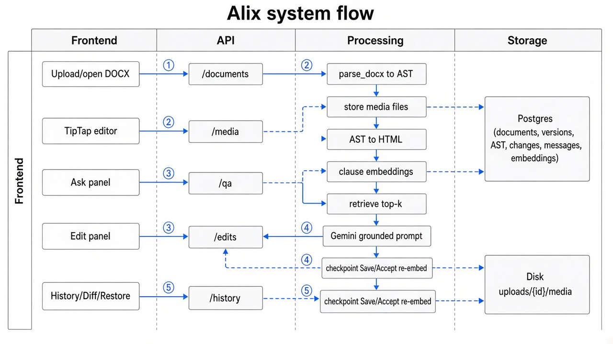
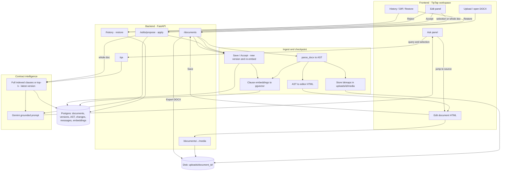

# Alix

AI-native contract workspace: import a DOCX, edit it in place, ask grounded questions, propose scoped AI edits, and keep a reviewable version history. Built with React + TypeScript + Vite + TipTap (frontend) and FastAPI + SQLAlchemy + pgvector (backend).


---

## What works today

| Area | Capability |
|------|------------|
| **Workspace (M1)** | Upload `.docx`, reopen stored docs, TipTap edit, Save, Export `.docx` |
| **Structure (M1)** | Headings, paragraphs, lists (incl. nested indent on export), tables, embedded bitmap images, `data-clause` anchors in AST→HTML |
| **AI Edit (M2)** | Select a passage or whole document → propose before/after → Accept / Reject |
| **Whole-doc edits (M2)** | Uses the full indexed contract when it fits (~48k chars); otherwise top matching clauses. Excerpts are uniquified so apply hits the right place; optional occurrence index |
| **Inline redlines (M2)** | Pending proposals show struck original + green inserted text in the editor |
| **Versions (M3)** | Save and Accept create checkpoints; Restore copies an older version forward |
| **History / audit (M3)** | Pending redlines with Accept/Reject, AI vs user changes, version linkage, conversation turns, filters, Jump-to-passage, audit timeline |
| **Ask (M4)** | Clause retrieval over the active document, selection-first `[Selected]` grounding, `[Source N]` citations, jump-to-passage, AST outline (incl. sub-clauses) |
| **Vectors (M4)** | Clause embeddings on ingest and on checkpoint; search uses the latest indexed version |

Media for embedded images is stored under `backend/uploads/{document_id}/media/` and served at `/api/v1/documents/{id}/media/{filename}`.

### Assessment modules

| Module | Status |
|--------|--------|
| **M1** Workspace import / edit / export | Done (happy path); Word numbering / headers-footers not full fidelity |
| **M2** AI scoped + document edits | Done (happy path + redlines / uniquified apply) |
| **M3** Redlines, versions, audit trail | Done (happy path + History filters / timeline) |
| **M4** Clause Q&A + navigation | Done (happy path; answers from retrieved passages) |
| **M5** Playbooks / public legal sources | Not started |

---

## System flow



<details>



</details>

---

## Known limitations

- Not a full Word clone: headers/footers, complex styles, and auto-numbering models are not fully preserved.
- Checkpointing re-parses via HTML ↔ DOCX; some structure can be lossier than the original ingest.
- Whole-document AI edits use the full indexed clause set when it fits the prompt budget; larger contracts fall back to top matching clauses. Apply is still text-based (HTML-aware / uniquified excerpts), not AST node-id patches.
- Inline redlines are TipTap decorations (strike + insert preview), not Word OOXML track changes.
- Ask answers from retrieved passages (`top_k`, default 12) plus an optional selected passage; it does not load the full document into every model call.
- **M5** (private playbooks / public legal refs / distinct source layers) is not implemented yet.

---

## Project structure

```text
alix-assessment/
├── readme-images/
│   ├── alix-workflow.jpg      # assessment architecture overview
│   └── alix-system-flow.png   # current product flow
├── docker-compose-local.yml   # db + backend + frontend
├── frontend/                  # React + TypeScript + Vite + TipTap
│   ├── src/
│   │   ├── api/               # documents, edits, qa, history, diff
│   │   ├── components/        # documents, editor, assistant
│   │   ├── pages/             # WorkspacePage
│   │   ├── App.tsx
│   │   └── main.tsx
│   ├── Dockerfile
│   └── package.json
└── backend/                   # Python app root — run backend from here
    ├── main.py
    ├── alembic/
    ├── admin/
    ├── api/                   # routers + services + backgrounds
    ├── core/
    │   ├── ast/               # DOCX parse, AST, diff helpers
    │   ├── config/settings.py
    │   ├── database.py
    │   ├── models/            # SQLAlchemy models (pgvector 3072-dim)
    │   ├── repositories/
    │   └── utils/export/      # AST/HTML/DOCX round-trip
    ├── ds/rag/                # embeddings, LLMs, prompts, vectorstores
    ├── tests/
    ├── uploads/               # per-document files + media/
    ├── requirements/
    └── .env
```

---

## Quick start (Docker)

From project root:

```bash
docker compose -f docker-compose-local.yml up -d
```

Copy `backend/.env.example` → `backend/.env`:

- Full Docker stack → `DB_HOST=db`
- DB container only → `DB_HOST=localhost`

Set `GEMINI_API_KEY` (and related embedding/LLM settings) for Ask and AI edits.

Uses `pgvector/pgvector:pg16` — pgvector is included automatically in Docker.

| Service | URL |
|---------|-----|
| Workspace | http://localhost:5173/ |
| API docs | http://localhost:8000/docs |

---

## Backend (local)

**Requirements:** Python 3.11+ (3.12 recommended)

### PostgreSQL + pgvector (without Docker)

- [PostgreSQL downloads](https://www.postgresql.org/download/)
- [pgvector installation](https://github.com/pgvector/pgvector#installation)

Enable pgvector once as superuser:

```sql
CREATE EXTENSION IF NOT EXISTS vector;
```

> Your app user (e.g. `alix`) cannot run this — use the `postgres` superuser.

### Run

```bash
cd backend
python -m venv venv
venv\Scripts\activate          # Windows
pip install -r requirements/backend.txt
copy .env.example .env         # DB_HOST=localhost, GEMINI_API_KEY=...

alembic upgrade head
uvicorn main:app --reload --port 8000
```

### Backend URLs

| Service | URL |
|---------|-----|
| Swagger | http://localhost:8000/docs |
| ReDoc | http://localhost:8000/redoc |
| Admin | http://localhost:8000/admin |
| Health | http://localhost:8000/test/ |

Admin login: `ADMIN_USERNAME` / `ADMIN_PASSWORD` in `backend/.env`.

### Tests

```bash
cd backend
.\venv\Scripts\python.exe -m pytest -q
```

---

## Frontend (local)

**Requirements:** Node.js 22+

### Stack

- React 18 + TypeScript
- Vite 8
- TipTap (contract editor on the workspace page)

### Run

```bash
cd frontend
npm install
npm run dev
```

### Frontend URLs

| Page | URL |
|------|-----|
| Workspace | http://localhost:5173/ |

### Scripts

| Command | Description |
|---------|-------------|
| `npm run dev` | Dev server (port 5173) |
| `npm run build` | Type-check + production build |
| `npm run preview` | Preview production build |
| `npm run lint` | ESLint check |
| `npm run lint:fix` | ESLint auto-fix |

### Configuration

| File | Purpose |
|------|---------|
| `package.json` | Dependencies, Node `>=22` engine |
| `vite.config.ts` | Vite dev server (`0.0.0.0:5173`) |
| `tsconfig.app.json` | TypeScript app config |
| `src/index.css` | App + editor styles |

### Docker

```bash
docker compose -f docker-compose-local.yml up -d frontend

# rebuild after dependency changes:
docker compose -f docker-compose-local.yml build frontend
docker compose -f docker-compose-local.yml up -d frontend
```

Frontend container uses `node:22-alpine` and mounts `./frontend` with a separate `node_modules` volume.

---

## Migrations

From `backend/`:

```bash
alembic revision --autogenerate -m "describe change"
alembic upgrade head
```

With Docker:

```bash
docker compose -f docker-compose-local.yml exec backend alembic upgrade head
```

---

## Git hooks

From project root (not `backend/`):

```bash
pip install pre-commit ruff
pre-commit install
```

Hooks:

- **Ruff** — Python (`backend/`)
- **ESLint** — TypeScript/React (`frontend/`)

On Windows, if git fails, disable **App execution aliases** for `git.exe` / `git.cmd` in Settings, then retry.
